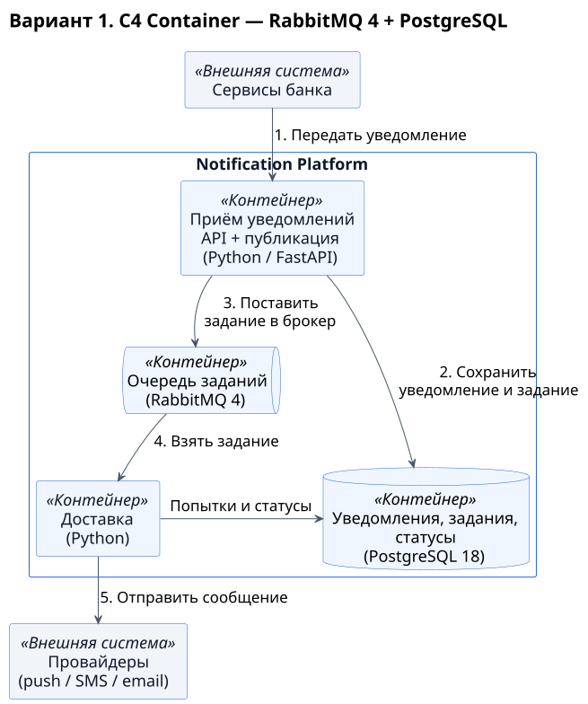
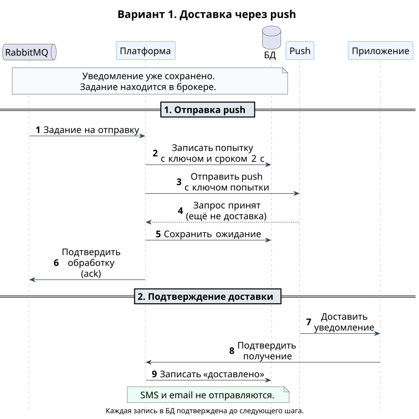
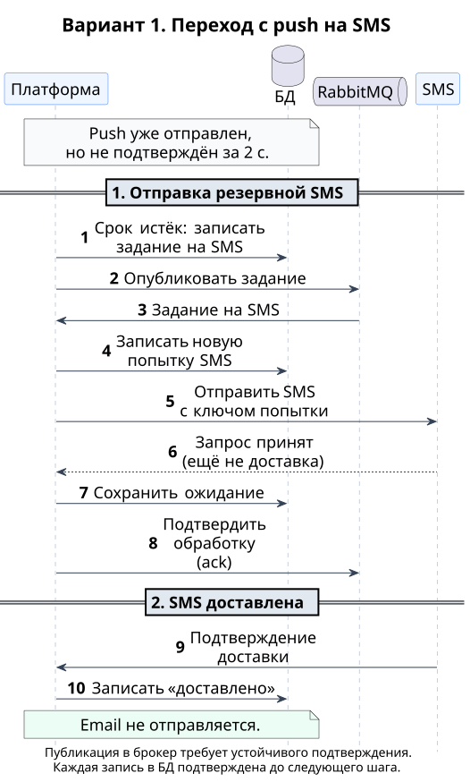
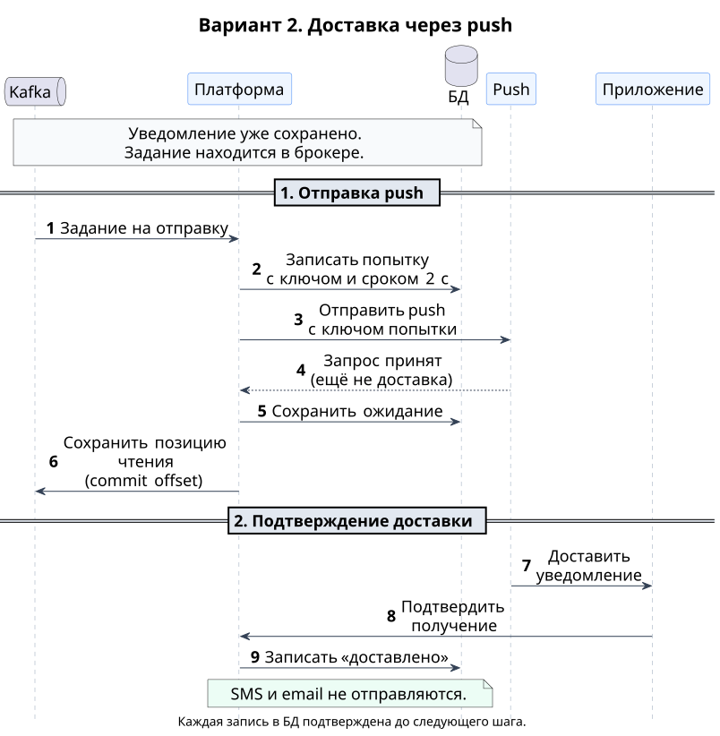
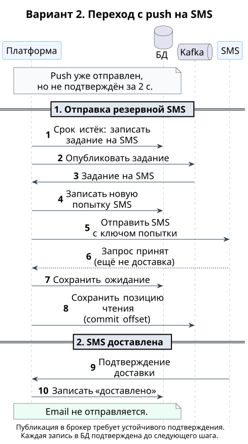

# Домашнее задание №4. Notification Platform

Платформа принимает транзакционные, сервисные и маркетинговые уведомления банка и доставляет их через push, SMS и email.

Бизнес-цели: **B1** — увеличить retention на 15%; **B2** — снизить число жалоб на 30%; **B3** — обеспечить доставку критичных сообщений.

## 1. Функциональные требования

| ID | Требование | Бизнес-цели |
|---|---|---|
| FR1 | Принимать уведомления трёх типов и возвращать отправителю идентификатор принятого сообщения | B1, B3 |
| FR2 | Доставлять уведомления через push, SMS и email по доступным контактам клиента | B1, B3 |
| FR3 | Для критичного сообщения автоматически переходить на резервный канал, если основной отказал или не подтвердил доставку вовремя | B3 |
| FR4 | Учитывать предпочтительный канал; разрешать отключение сервисных и маркетинговых сообщений, но не критичных | B1, B2, B3 |
| FR5 | Повтор одного события для того же клиента в течение 30 суток должен возвращать прежний ID; изменение содержания под тем же событием должно отклоняться | B2, B3 |
| FR6 | Показывать историю попыток и результат; при исчерпании каналов сообщать поддержке и позволять возобновить доставку | B2, B3 |
| FR7 | Обрабатывать кампанию до 1 млн клиентов, сохраняя сроки доставки критичных сообщений | B1, B3 |

Все FR обязательны — MUST HAVE.

## 2. Нефункциональные требования

Это проектные цели SLO. Задержка считается от приёма платформой до сохранения подтверждения; месячные показатели включают отказы провайдеров.

| ID | Приоритет | Измеримое требование |
|---|---|---|
| NFR1 | MUST | Приём: p99 ≤ 200 мс. Подтверждение критичных: p95 ≤ 5 с, p99 ≤ 30 с |
| NFR2 | MUST | Принимать 5 000 сообщений/с в течение 15 минут по профилю, рассчитанному в RFC; обработать кампанию 1 млн адресатов за 15 минут |
| NFR3 | MUST | Доступность приёма ≥ 99,95% в месяц; при одиночном отказе не терять подтверждённые задания и восстанавливать работу за ≤ 60 с |
| NFR4 | MUST | Подтвердить ≥ 99,99% критичных за 24 ч при наличии канала, доступного достаточно долго для очередной попытки и подтверждения, и достаточной квоты провайдера |
| NFR5 | MUST | Повтор запроса или внутреннего задания не создаёт новое логическое уведомление в 30-дневном окне; ключи незавершённых критичных сохраняются до разбора |
| NFR6 | MUST | Сохранять историю для 100% критичных; создавать инцидент за ≤ 60 с после исчерпания быстрой цепочки |
| NFR7 | SHOULD | При исправном push и стандартном предпочтении ≥ 90% критичных должны завершаться без платной SMS |

## 3. Архитектурно значимые требования (ASR)

P0 — обязательны для запуска критичной доставки; P1 — обязательны для запуска всей платформы.

| ASR | Приоритет | Связанные требования | Почему влияет на архитектуру |
|---|---|---|---|
| ASR1. Низкая задержка критичных при кампании | P0 | FR3, FR7, NFR1 | Нужны отдельные очереди и работники, чтобы массовые сообщения не задерживали критичные |
| ASR2. Сохранность и восстановление доставки | P0 | FR1–FR3, FR6, NFR3–NFR4, NFR6 | Определяет момент подтверждения приёма, устойчивое состояние, таймеры и повтор после сбоя |
| ASR3. Контроль повторов при failover | P0 | FR5, NFR5 | Требует уникального события, отдельных попыток и согласования таймера с поздним подтверждением |
| ASR4. Массовая нагрузка | P1 | FR7, NFR2 | Требует буферизации, ограничения входа и горизонтального масштабирования |

## 4. Ключевые архитектурные вопросы

| Вопрос | Источник | Почему важен |
|---|---|---|
| Когда можно подтвердить приём и как не потерять задание между БД и брокером? | ASR2, FR1, NFR3 | Ответ до устойчивой записи оставляет риск потери при сбое |
| Когда переключать канал и что делать с поздним подтверждением? | ASR1–ASR3, FR3, FR5 | Бесконечное ожидание задерживает доставку, слишком ранний резерв увеличивает повторы |
| Как не дать кампании занять ресурсы критичной доставки? | ASR1, ASR4, FR7, NFR2 | Отдельной очереди недостаточно, если заняты все работники или квота провайдера |

## 5. Архитектурные последствия ASR

| ASR | Последствия |
|---|---|
| ASR1 | Отдельные очереди/топики и пулы критичных работников, резерв провайдерской квоты, ограничение маркетинга |
| ASR2 | БД с репликами, атомарная запись уведомления и задания, подтверждения брокера, восстановимые таймеры |
| ASR3 | Уникальный ключ события, устойчивый ключ каждой попытки, блокировка состояния, подавление повторных подтверждений |
| ASR4 | Разбиение потока на очереди/партиции, дополнительные работники, контроль накопившихся заданий |

## 6. Решения, которые не подходят

| Решение | Нарушенный ASR | Почему |
|---|---|---|
| Синхронно отправлять уведомление из обработки перевода | ASR1, ASR2 | Перевод зависит от внешнего провайдера; сбой процесса может потерять незаписанное уведомление |
| Одна общая FIFO-очередь и неограниченный общий пул для всех типов | ASR1, ASR4 | Миллион маркетинговых заданий задерживает критичные и расходует их ресурсы |

## 7. Неопределённости и риски

| Что неизвестно | Как проверить |
|---|---|
| Поддерживают ли провайдеры ключи идемпотентности, поиск статуса и достоверные подтверждения? | Контрактные тесты: потерять ответ, повторить ключ, получить позднее подтверждение |
| Каковы реальные пики и предел выбранной БД/брокера? | Собрать статистику входа; проверить профиль нагрузки вместе с миллионной кампанией и отказом узла |
| Сколько push подтверждается за 2 с и сколько стоит резерв SMS? | Пилот на разных устройствах и сетях, измерение задержек и доли SMS, проверка тарифов и квот |

## 8. RFC: доставка критичных уведомлений с переключением каналов

| Метаданные | Значение |
|---|---|
| Статус | DESIGN |
| Автор(ы) | Vladislav Prokofev |
| Ответственный | Автор репозитория |
| Бизнес-заказчик | Владелец Notification Platform, роль из условия |
| Ревьюеры | Преподаватель; ревью ещё не проведено |
| Дата создания | 2026-11-17 |
| Дата обновления | 2026-11-17 |

### Оглавление

1. [Контекст](#контекст)
2. [Продуктовый анализ](#продуктовый-анализ)
3. [Пользовательские сценарии](#пользовательские-сценарии)
4. [Статистика](#статистика)
5. [Требования](#требования)
6. [Варианты решения](#варианты-решения)
7. [Сравнительный анализ](#сравнительный-анализ)
8. [Выводы](#выводы)
9. [Связанные задачи](#связанные-задачи)
10. [Приложения](#приложения)

### Контекст

#### Ключевые вопросы

- Проблема: независимая отправка командами банка приводит к задержкам, повторам и потерям сообщений.
- Актуальность: массовые кампании и нестабильные провайдеры усиливают эти сбои.
- Участники: клиенты, команды банка и поддержка. Банковская операция не должна ждать отправки уведомления.

### Продуктовый анализ

Быстрое подтверждение операций поддерживает доверие и retention (B1). Настройки и подавление повторов уменьшают раздражение и жалобы (B2). Резервные каналы и история попыток обеспечивают контролируемую доставку (B3).

Рост retention и снижение жалоб проверяются на сопоставимых когортах до и после внедрения. Архитектура создаёт условия для этих изменений, но сама по себе не доказывает продуктовый эффект.

### Пользовательские сценарии

| Приоритет | Тип | Действующее лицо | Сценарий |
|---|---|---|---|
| MUST HAVE | Основной | Клиент | Получает push после перевода; приложение подтверждает получение, резерв не отправляется |
| MUST HAVE | Failover | Клиент | Push не подтверждён вовремя; получает SMS, после её подтверждения email не отправляется |
| MUST HAVE | Настройки | Клиент | Выбирает первый канал и отключает необязательные типы; критичные остаются включены |
| MUST HAVE | Недоставка | Поддержка | Видит причины отказов и возобновляет доставку после устранения проблемы |

MUST HAVE — обязательно; SHOULD HAVE — желательно; COULD HAVE — опционально.

### Статистика

MAU — 10 млн, DAU — 3 млн, одновременно активны до 300 000. Суточная частота считается на DAU. Проектные допущения: обычный пик равен среднему ×10; кампания на 1 млн клиентов должна пройти за 15 минут.

#### Расчёт нагрузок

| Тип | Уведомлений/сутки | Среднее/с |
|---|---:|---:|
| Транзакционные | 3 млн × 2 = 6 млн | 69,4 |
| Сервисные | 3 млн × 3 = 9 млн | 104,2 |
| Маркетинговые | 3 млн × 5 = 15 млн | 173,6 |
| **Итого** | **30 млн** | **347,2** |

```text
Кампания:                1 000 000 / 900 ≈ 1 111 сообщений/с
Пик вместе с кампанией:  347,2 × 10 + 1 111 ≈ 4 583 сообщений/с
Профиль с запасом:       1 000 критичных + 1 100 сервисных + 2 900 маркетинговых = 5 000/с
```

Кампания добавлена поверх обычного потока как запас. Число одновременных пользователей не равно числу запросов в секунду: здесь нагрузку создают события банка.

Если каждое критичное сообщение пройдёт три канала, получится до 1 000 × 3 + 1 100 + 2 900 = **7 000 попыток/с**. Резерв SMS требует квоты до **1 000/с**. Для необязательных сообщений автоматического резерва нет.

При допущении, что SMS нужна для 10% критичных, это 600 000 SMS в сутки. При цене одной SMS **C** расход равен 600 000 × C; поэтому push первым и корректный таймер имеют значение для стоимости.

### Требования

#### Функциональные требования

Используются FR1–FR7 из раздела 1: единый приём, три канала, резерв критичных, настройки, дедупликация, история и массовые кампании. Все обязательны.

#### Нефункциональные требования

Используются NFR1–NFR7 из раздела 2. ASR1–ASR3 имеют приоритет P0, ASR4 — P1. Соответствие обоих вариантов каждому ASR приведено ниже.

### Варианты решения

#### Общий механизм доставки

1. **Сохранить.** Сервис банка устойчиво сохраняет событие и повторяет его передачу до подтверждения платформы. API записывает уведомление и задание на публикацию (outbox) одной транзакцией в PostgreSQL. Только после commit возвращается ID. Уникальный ключ `(отправитель, событие, клиент)` и проверка содержания выполняют FR5.
2. **Выбрать канал.** По умолчанию цепочка — **push → SMS → email**. Предпочтительный доступный канал ставится первым, оставшиеся добавляются в стандартном порядке. Критичные отключить нельзя; для остальных перед отправкой проверяется актуальное согласие, используется один доступный канал.
3. **Отправить.** Фоновый издатель передаёт outbox брокеру и отмечает публикацию после подтверждения. Обработчик сохраняет попытку с постоянным ключом и сроком ожидания, затем обращается к провайдеру вне транзакции. После записи результата шага подтверждает задание брокеру.
4. **Дождаться результата.** Принятие запроса провайдером ещё не означает доставку. Ждём подтверждение: push — 2 с, SMS — 5 с, email — 10 с. Явный отказ запускает резерв сразу. Таймер хранится в БД и после истечения создаёт новое задание через outbox.
5. **Завершить или продолжить.** Подтверждение приложения, SMS delivery report или почтового сервера завершает уведомление; ещё не начатые шаги отменяются. Если все каналы исчерпаны, сохраняется состояние для разбора, создаётся инцидент, повторы выполняются с увеличивающимся интервалом до 15 минут. После суток без результата поддержка определяет дальнейшие действия; сообщение не удаляется.

При повторе задания используется сохранённая попытка. Состояние меняется под блокировкой строки; повторный callback игнорируется, успех не откатывается поздней ошибкой. Старый отказ не меняет срок новой попытки. Подтверждения проверяются по подписи и ID попытки.

**Граница гарантии.** Гарантируются сохранность принятого задания и повторяемая обработка; внешняя доставка зависит от доступного канала и квот, как указано в NFR4. Прочтение человеком не гарантируется. Если push доставлен, но подтверждение потеряно, SMS может создать физический повтор. Ключ провайдера предотвращает повтор одного вызова только при поддержке идемпотентности; без неё сначала уточняется статус. При неизвестном исходе приоритет отдаётся доставке.

**Наблюдаемость.** Сохраняются попытки, время, канал и причина результата. Метрики: задержка, накопленные задания, доставка/отказы, переходы между каналами, повторные подтверждения разных каналов, доля и стоимость SMS. Prometheus и Grafana показывают эти показатели; при исчерпании цепочки появляется инцидент.

#### Вариант 1. RabbitMQ + PostgreSQL

##### Архитектура

Python/FastAPI принимает уведомления и подтверждения, публикует outbox; отдельные Python-работники доставляют сообщения. PostgreSQL 18 хранит состояние. RabbitMQ 4 с quorum queues распределяет задания. Для критичных и массовых сообщений используются отдельные очереди, пулы работников и квоты. При перегрузке маркетинг ограничивается первым.

PostgreSQL — primary и две реплики, приём подтверждается после записи на primary и одну синхронную реплику. При переключении продвигается реплика с подтверждёнными данными, старый primary лишается права записи. RabbitMQ — три узла; publisher confirm подтверждает сохранение задания кворумом. Публикация проверяет маршрутизацию (`mandatory`/`basic.return`); обработчик отправляет manual ack после записи результата шага в БД.



В sequence участник «Платформа» объединяет приём и обработку. Успех: уведомление уже принято, задание из очереди приводит к push и подтверждению приложения.



Failover: продолжение после 2 с без подтверждения push; успех SMS останавливает цепочку.



PlantUML: [C4](diagrams/a-containers.puml), [успех](diagrams/a-success.puml), [failover](diagrams/a-failover.puml).

##### Этапы реализации

Оценки даны при готовых контрактах провайдеров для прототипа и пилотной интеграции.

| Этап | Срок | Ресурсы | Риск |
|---|---|---|---|
| Приём, состояние и outbox | Неделя 1 | 2 backend | Ошибки ключей событий |
| Очереди, каналы, таймеры и подтверждения | Недели 2–3 | 2 backend, SRE | Квоты и неизвестные исходы провайдера |
| Проверки отказов/нагрузки и пилот | Неделя 4 | Backend, QA, SRE | Не выполнены SLO |

##### Преимущества

- Очередь напрямую соответствует задаче: получить работу, сохранить результат, подтвердить обработку.
- Работники масштабируются отдельно от приёма.

##### Недостатки

- История и длительное восстановление требуют БД; брокер не заменяет её.
- Outbox может публиковаться повторно, поэтому дедупликация обязательна.

#### Вариант 2. Kafka + PostgreSQL

##### Архитектура

Приём, PostgreSQL, настройки и автомат доставки те же. Вместо RabbitMQ используется Kafka 4 в режиме KRaft. Отдельные топики и группы работников обслуживают критичные и массовые сообщения. Ключ записи — `notification_id`.

Kafka — три узла, replication factor 3, `min.insync.replicas=2`, публикация с `acks=all` и идемпотентным producer; выбор несогласованной реплики лидером запрещён. После записи результата в PostgreSQL consumer подтверждает offset — позицию чтения. Подтверждается только непрерывно завершённый префикс; после сбоя или rebalance незавершённые записи повторяются с проверкой состояния в БД.

Ожидание доставки не блокирует consumer: продолжение инициирует таймер через outbox. Exactly-once внутри Kafka не распространяется на внешнюю SMS и PostgreSQL, поэтому нужны те же ключи и правила повторов.


Успех: событие прочитано, результат шага записан до commit offset; приложение подтверждает push.



Failover: таймер публикует задание SMS; подтверждение SMS завершает уведомление.



PlantUML: [C4](diagrams/b-containers.puml), [успех](diagrams/b-success.puml), [failover](diagrams/b-failover.puml).

##### Этапы реализации

| Этап | Срок | Ресурсы | Риск |
|---|---|---|---|
| Приём, состояние и outbox | Неделя 1 | 2 backend | Ошибки ключей событий |
| Kafka, группы, каналы и таймеры | Недели 2–4 | 2 backend, SRE | Ошибки offset и повторной обработки |
| Проверки отказов/нагрузки и пилот | Неделя 5 | Backend, QA, SRE | Задержки при rebalance |

##### Преимущества

- Журнал допускает повторное чтение и независимых потребителей, например аналитику.
- Партиции позволяют распределять обработку между работниками.

##### Недостатки

- Добавляются управление offset, rebalance и сроком хранения журнала.
- БД и таймеры всё равно нужны; гарантия внешней доставки не улучшается.

### Сравнительный анализ

#### Ресурсные требования

| Критерий | RabbitMQ | Kafka |
|---|---|---|
| Время | Оценка 4 недели | Оценка 5 недель |
| Команда | 2 backend, SRE и QA частично | Та же, нужен опыт Kafka |
| Инфраструктура | 3 узла RabbitMQ, 3 узла PostgreSQL, приложения | 3 узла Kafka, 3 узла PostgreSQL, приложения |
| Организационный риск | Контракты каналов и эксплуатация | Те же плюс сопровождение групп и повторного чтения |

Число узлов определяет отказоустойчивость; их мощность выбирается проверкой рассчитанного профиля нагрузки.

#### Соответствие требованиям

Общая политика каналов выполняет FR2/FR4 и поддерживает NFR7; история и метрики — FR6/NFR6. Остальные связи заданы в разделе 3.

| ASR | RabbitMQ | Kafka |
|---|---|---|
| ASR1 | Критичная очередь, свой пул и резерв квоты | Критичный топик, своя группа и резерв квоты |
| ASR2 | Outbox, quorum confirm, ack после БД, устойчивый таймер | Outbox, acks=all, offset после БД, тот же таймер |
| ASR3 | Ключ события/попытки, блокировка состояния и повторяемая обработка | Те же механизмы; порядок партиции не заменяет согласование подтверждений |
| ASR4 | Дополнительные очереди и работники, ограничение маркетинга | Дополнительные партиции и consumers, ограничение маркетинга |

### Выводы

**Выбран RabbitMQ + PostgreSQL:** задача состоит в выполнении конечных заданий. Для неё очередь с явным подтверждением проще журнала с offset и rebalance. Рассчитанный пик около 4 600/с сам по себе не требует Kafka; оба варианта должны подтвердить SLO на стенде.

Компромиссы: синхронная репликация увеличивает задержку и может остановить новый приём при отказе реплик; отдельные пулы и зарезервированные квоты иногда простаивают. Таймер push 2 с ускоряет резерв, но увеличивает расходы SMS и риск позднего повтора. При отказе всех каналов срок доставки не гарантируется, задание остаётся под контролем поддержки.

Kafka становится предпочтительнее, если требуется длительное повторное чтение потока несколькими независимыми потребителями. Этих требований в текущем кейсе нет.

### Связанные задачи

1. Проверить контракты подтверждений, идемпотентности и квоты провайдеров.
2. Реализовать приём/outbox, автомат попыток и восстановимые таймеры.
3. Проверить рассчитанный поток с кампанией, сбой между отправкой и записью результата, поздние подтверждения и отказ узла.
4. Провести пилот; при переключении исключить параллельную отправку одного события старой и новой системами.

### Приложения

#### Глоссарий

| Термин | Значение |
|---|---|
| Failover | Переход к резервному каналу |
| Outbox | Задание на публикацию, сохранённое одной транзакцией с уведомлением |
| Идемпотентность | Повтор операции с тем же ключом не создаёт новый эффект в пределах контракта |
| SLO; p95 / p99 | Целевой показатель; порог для 95% / 99% измерений |
| Offset / rebalance | Позиция чтения Kafka / перераспределение партиций между читателями |
